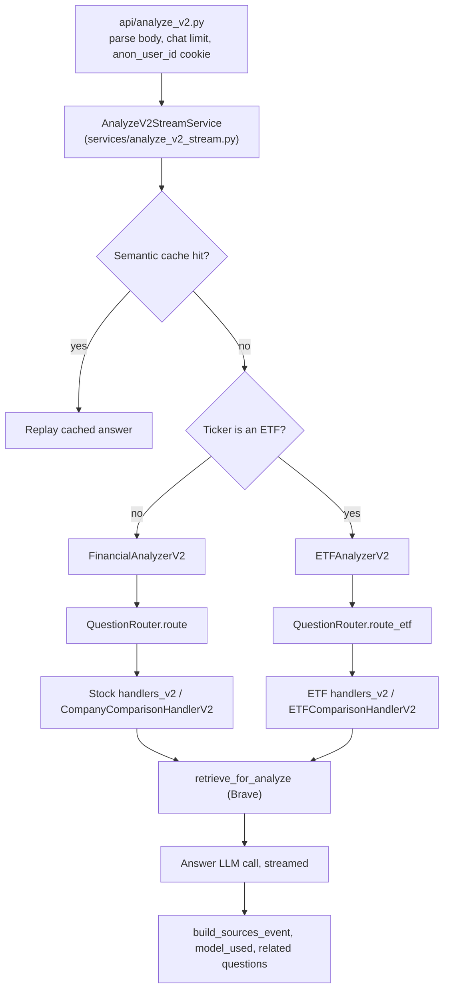

# `POST /api/v2/companies/{ticker}/analyze` — request flow

The chat endpoint for stocks and ETFs. The client sends a question (plus an optional `conversationId`); the API streams
**Server-Sent Events**: progress lines, the answer, sources and follow-up questions. Every question costs **one routing
LLM call**, then (when search is on) Brave retrieval, then the answer call.

---

## 1. Layers

- **`AnalyzeV2StreamService`** normalizes the ticker, checks whether it is an ETF, loads conversation history
  (stored per user + ticker, ETFs under `etf_{TICKER}`), emits `conversation`, runs the semantic cache, picks the
  analyzer, splits HTML/visual blocks out of the answer stream and stores the assistant reply.
- **`FinancialAnalyzerV2`** (stocks) handles URLs in the question first: a non-SEC PDF goes straight to the model
  (no routing), an SEC filing URL forces search on. It then fetches the ticker's available periods/metrics and routes.
- **`ETFAnalyzerV2`** reads the fund's row once (it feeds the router prompt and the handlers) and routes.

---

## 2. Routing: one LLM call

`QuestionRouter` (`services/question_analyzer/router.py`) sends one structured-JSON prompt with the question, the
viewed ticker, what our database has for it and the last two conversation turns. The JSON gives:

| Field | Stock (`route`) | ETF (`route_etf`) |
|---|---|---|
| `standalone_question` | follow-ups rewritten so they stand alone (used for retrieval) | same |
| `question_type` | `company-general`, `company-specific-finance`, `general-finance`, `company-comparison` | `general_etf`, `etf_overview`, `etf_detailed_analysis` |
| data requirement | `none`, `basic`, `detailed`, `quarterly_summary`, `annual_summary` (+ periods, statements) | `none`, `basic`, `detailed` |
| `use_web_search` + `reason_code` | search on/off and why | same |
| `search_queries` | 1-3 Brave queries built from the standalone question | same |

The analyzer runs the router concurrently with the ticker extractor (`StockTickerExtractor` / `ETFTickerExtractor`).
**Comparisons are decided by the extractor**: 2+ resolved tickers make the question a comparison; the router's
decision (search, queries, standalone question) still drives retrieval.

Deterministic overrides after routing (`apply_fast_paths` / `apply_etf_fast_paths`):

- static-fact questions (founders, headquarters, IPO date, name origin) turn search off (`stable_concept`);
- an SEC filing URL forces search on (`sec_url`, stocks);
- "quarterly report", "10-Q", "annual report", "10-K"… force a filing summary (stocks).

**Fallbacks (no extra LLM call):**

- Router timeout (3 s) or invalid JSON → `default_routing` (stocks: `company-general` with a ticker, else
  `general-finance`; data `none`; search on with the question as the query) or `default_etf_routing` (`etf_overview`
  with a ticker, else `general_etf`; search on).
- Router says `company-comparison` but the extractor found fewer than 2 tickers → the router's result is kept and the
  type is downgraded: `company-specific-finance` if it asked for data, else `company-general`, or `general-finance`
  without a ticker.

---

## 3. Handlers and retrieval

| Question type | Handler | Database context |
|---|---|---|
| `general-finance` | `GeneralFinanceHandlerV2` | none |
| `company-general` | `CompanyGeneralHandlerV2` | company name/country |
| `company-specific-finance` | `CompanySpecificFinanceHandlerV2` | fundamentals + statements for the planned periods; only the relevant statement families; filing summaries read the 10-Q/10-K instead of searching |
| `company-comparison` | `CompanyComparisonHandlerV2` | each company's data, Brave per ticker |
| `general_etf` / `etf_overview` / `etf_detailed_analysis` | `GeneralETFHandlerV2` / `ETFOverviewHandlerV2` / `ETFDetailedAnalysisHandlerV2` | none / core metadata / holdings, sectors, countries |
| ETF comparison | `ETFComparisonHandlerV2` | each fund's row |

When search is on, handlers call `retrieve_for_analyze` (`services/analyze_retrieval/`) with the router's standalone
question and queries (`PrecomputedQueryReformulator`, so no reformulation LLM call; the comparison handlers still
reformulate per ticker). Retrieval picks the market from the company's country or the question, runs Brave with
freshness and a trusted-publisher goggle, ranks and dedupes sources and selects passages. The prompt then carries the
passages and grounding rules: answer from the sources, from the database, from training knowledge for stable facts, or
decline when nothing grounds the answer. ETF handlers force search when the fund's row is incomplete.

`useUrlContext: true` with a URL in the question ingests that page instead of searching (stocks only).

---

## 4. SSE events

Each event is one JSON object followed by a blank line. Roughly in order:

| `type` | When |
|---|---|
| `conversation` | always first: `{"conversationId": ...}` |
| `attachment_url` | a URL in the question, or the 10-Q/10-K used for a filing summary |
| `thinking_status` | progress lines with `phase`/`step`: database vs "Searching for the latest…", `Searching for "<query>"…`, trusted publishers read, data loading, analysis |
| `debug_prompt_context` | only with `debugPromptContext: true`: the final prompt and the retrieved sources/passages |
| `answer` | streamed answer text |
| `answer_visual_start` / `answer_visual_delta` / `answer_visual_done` / `answer_visual_error` | a fenced HTML/visual block split out of the answer |
| `sources` | the retrieved Brave sources (`source_id`, `url`, `title`, `publisher`, `published_at`, `is_trusted`) |
| `model_used` | model that wrote the answer |
| `data_sources` | stock comparisons: database vs training data per ticker |
| `related_question` | follow-up suggestions (generated while the answer streams) |
| `cache_meta` | cache replays only: `{"semantic_cache_hit": true}` |
| `error` | `retrieval_failed` (Brave error) or `url_ingest_failed` |

---

## 5. Semantic cache

Off unless `SEMANTIC_CACHE_ENABLED` is set. Entries live under `v2:{TICKER}` for 30 minutes and are skipped for
requests with no ticker, a URL in the question, `useUrlContext`, filing-report questions or `disableCache: true`. A hit
replays the stored answer, sources, model and related questions without calling the analyzer.

---

*Keep this doc conceptual; implementation details live in code and change often.*
