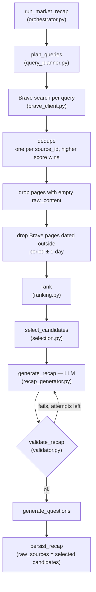
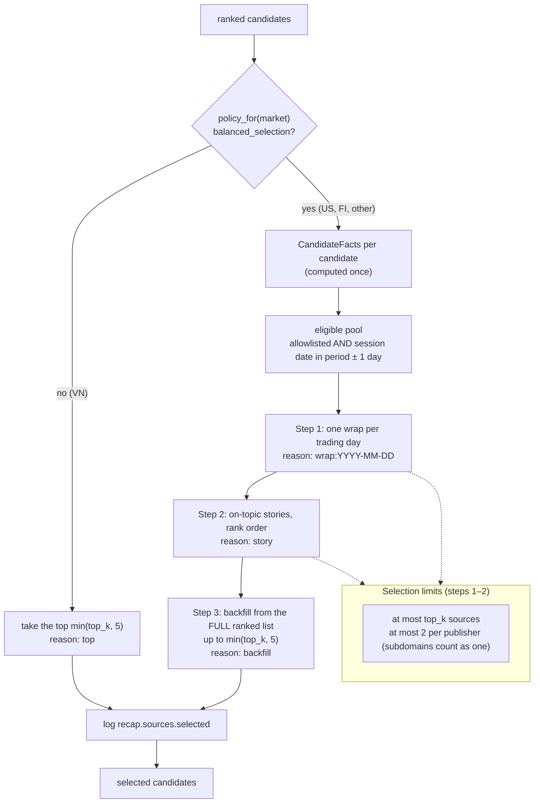
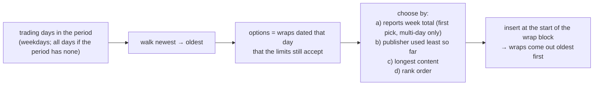

# Market Recap — Source Selection

How a market recap picks the sources it is written from. Code: `services/market_recap/`
(`retrieval.py` → `ranking.py` → `selection.py`, with rules in `criteria.py` and dates in `session_dates.py`).

## 1. End to end



`retrieve_candidates` (`retrieval.py`) covers B–H and returns the selected candidates in a `RetrievalResult`.

## 2. Rank: order the pool best first

`rank(candidates, market)` sorts by this key, first difference wins:

| # | Key | Notes |
|---|---|---|
| 1 | allowlisted first | `source_policy.is_allowlisted` |
| 2 | market relevance | FI only: +6 unless the page mentions Finland/Helsinki/OMXH… |
| 3 | page quality + topic penalty | `_quality_rank` (hubs, video, live pages, short pages demoted). Article-path bonus only for plain markets (VN). US topic penalty: +3 if a market word is only in the body, +6 if nowhere |
| 4 | newest first | Brave `published_date` |
| 5 | Brave score, then URL | tie-breaks; Brave score is always 0.0 today |

## 3. Select: pick from the ranked list



Step order is priority: wraps take publisher slots before stories. Backfill ignores eligibility and the publisher
cap, because a recap needs at least 5 sources (`MIN_SOURCES`) to work from. `top_k` (10) is a ceiling, not a quota.

### Facts computed once per candidate (`criteria.CandidateFacts`)

| Fact | Rule |
|---|---|
| `allowlisted` | publisher is on the market's allowlist |
| `session_date` | title date → URL date → Brave date (first that parses; see §4) |
| `is_session_wrap` | article page AND names enough index names (US: 2 of S&P / Dow / Nasdaq; FI: 1 of OMX Helsinki / OMXH25 / Helsinki 25) |
| `reports_week_total` | US body says "for/on the week" or "weekly loss/gain" |
| `is_on_topic_story` | article page AND ≥ 300 chars AND market-relevant (FI) AND a market word in the title (US) |
| `content_chars` | length of `raw_content` |

"Article page" = the URL path has a digit (date or id) and isn't `/video`.

### Step 1 — one wrap per trading day



The latest day picks first, so it gets first choice of publisher slots, and its wrap can carry the week's totals.

### Example (illustrative US week, top_k = 10)

```
ranked pool (~60 pages)
  └─ eligible (allowlisted, dated Sun–Sat)
       ├─ wraps:   Mon cnbc · Tue apnews · Wed nytimes · Thu bloomberg · Fri apnews(week totals)
       ├─ stories: reuters · reuters · wsj · cnbc        (rank order; apnews already at 2)
       └─ backfill: not needed (9 ≥ 5)
selected = 9 sources, logged as ["wrap:2026-11-02 cnbc.com", …, "story wsj.com", …]
```

## 4. Session date (`session_dates.session_date`)

Brave's date can be the crawl date, so the page's own date wins:

1. **Title** — "Nov. 4" (year inferred from `period_end`) or "11/4/2026" (month first; VN is day first, so skipped).
2. **URL** — `2026/11/04`, `2026-11-04` or `20261104` in the path.
3. **Brave `published_date`**.

A date that doesn't parse (e.g. "Feb. 30") falls through to the next source.

## 5. Per-market rules (`criteria.MarketPolicy`)

| Market | Selection | Wrap index names | Topic words in title | Relevance hints | Week-total phrases |
|---|---|---|---|---|---|
| US | balanced | S&P, Dow, Nasdaq (2 needed) | yes | — | yes |
| FI | balanced | OMX Helsinki, OMXH25, Helsinki 25 (1) | — | Finland, Helsinki, OMXH… | — |
| VN | plain top 5 (+ article-path bonus in rank) | — | — | — | — |
| other | balanced | — (no wraps) | — | — | — |

VN keeps the plain top 5: balanced selection didn't beat it in before/after recap judging, and VN outlook pieces
name VN-Index too, so index names can't identify a session wrap there.

## 6. Log event `recap.sources.selected`

Emitted once per `select_candidates` call.

| Field | Meaning |
|---|---|
| `market` | e.g. `"US"` |
| `count` | number of selected sources |
| `sources` | `"<reason> <publisher>"` per source in output order; reason is `wrap:<date>`, `story`, `backfill` or `top` |
